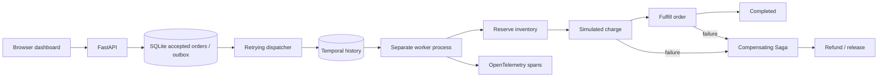

# CrashProof

**Break a worker. Replay a request. Watch the workflow keep its promises.**

[](https://github.com/Sanjana432/crashproof/actions/workflows/ci.yml)


A working distributed-systems laboratory built with **Temporal, FastAPI, SQLite and OpenTelemetry**. Submit an order, inject a failure and inspect durable workflow history, transactional side effects and real telemetry spans. The included crash demonstration terminates an actual worker process after a simulated charge commits, starts a fresh worker and checks that recovery creates no second charge.

The dashboard shows the selected order’s workflow route and compensation branch alongside its recorded events. Open the local app to try it with a live order.

Earlier interface screenshots are available for [desktop](docs/dashboard.jpg) and [mobile](docs/mobile.jpg).

## What this demonstrates

- **Actual durable execution:** a Temporal service stores workflow history; business logic runs in separate worker processes.
- **Request idempotency:** the same key and payload returns the same order; reusing a key with a different payload is rejected.
- **Persistent dispatch:** accepted orders stay in a transactional outbox and are dispatched after an API restart or server reconnection.
- **Activity idempotency:** inventory reservations, charges, refunds and releases apply their effects once per order.
- **Saga compensation:** a fulfillment rejection triggers a refund and inventory release; a payment decline releases inventory.
- **Human approval:** a workflow can pause before payment and continue after a Temporal signal.
- **Commit-boundary crash:** an opt-in dedicated worker exits after committing a charge but before acknowledging activity completion.
- **Observability:** business-event timeline, Temporal history download, actual OpenTelemetry business-operation spans and Prometheus-format gauges.

Payments and fulfillment are **simulated local services**. No money moves, and no payment credentials are used. The application does not claim universal exactly-once execution: Temporal retries activities, while the business service makes repeated effects idempotent.

## Start locally

Install Python 3.11 or newer and the [Temporal CLI](https://docs.temporal.io/cli). From this repository:

```bash
python -m venv .venv
# Windows PowerShell:
.venv\Scripts\Activate.ps1
# macOS / Linux: source .venv/bin/activate
python -m pip install -e .
```

Open three terminals in the repository and activate the environment in each:

```bash
# Terminal 1: real Temporal service, persistent workflow history and UI
temporal server start-dev --ip 127.0.0.1 --port 7233 --db-filename data/temporal.db

# Terminal 2: dedicated worker; this flag permits deliberate demo-process exits
python -m crashproof worker --allow-crash

# Terminal 3: API and dashboard
python -m crashproof server
```

Open **http://127.0.0.1:8101**. The Temporal UI is **http://127.0.0.1:8233**, and the API explorer is **http://127.0.0.1:8101/docs**.

Create the `data` directory first if your Temporal CLI version does not create a missing parent directory. Keep the Temporal database and business database files across restarts to preserve both kinds of state.

The API can start before Temporal. Requests are saved locally and dispatched when the service becomes available. A connected Temporal service does not imply that a worker is running; queued orders require a worker on the configured task queue.

## A five-minute interview demonstration

1. Submit a **happy-path** order and inspect its reservation, charge and completion events.
2. Click **Replay identical request**. Confirm there is one order and one charge.
3. Choose **Temporary payment failure**. Inspect the two payment attempts and single committed charge.
4. Choose **Fulfillment rejected**. Show the refund and released reservation.
5. Check **Pause for manual approval**, then approve or reject the order.
6. Choose **Crash after charge** using the dedicated crash-enabled worker. The worker exits with code `78`. Start the same worker command again; Temporal retries the timed-out activity, the payment ledger deduplicates it, and the order completes.

For an automated, isolated crash/restart demonstration while the Temporal service is running:

```bash
python -m crashproof demo
```

This command creates its own task queue, business database and worker subprocesses. It exits only its own workers, leaving your normal dashboard worker and the Temporal service intact. The resulting JSON records the actual exit code, final state and effect counts.

## Architecture



See [architecture and correctness boundaries](docs/architecture.md) and [demo commands](docs/demo.md).

## Test and benchmark

```bash
# Unit + HTTP contract tests; real Temporal tests skip unless the address is set
python -m unittest discover -s tests -v

# PowerShell: enable actual Temporal integration tests
$env:TEMPORAL_ADDRESS="127.0.0.1:7233"
python -m unittest discover -s tests -v

# macOS / Linux equivalent:
# TEMPORAL_ADDRESS=127.0.0.1:7233 python -m unittest discover -s tests -v

# Real workflow-throughput/latency benchmark, with its own worker and database
python -m crashproof benchmark --orders 30 --concurrency 5
```

Tests cover concurrent submissions, oversell prevention, request mismatches, late activity calls, refunds, invalid API input and real Temporal retries/compensation/signals. [Recorded development evidence](docs/validation.md) includes the genuine process-crash run and a measured benchmark. The benchmark covers workflow execution and business writes, excluding browser and HTTP latency.

## Configuration

| Variable | Default | Purpose |
|---|---|---|
| `TEMPORAL_ADDRESS` | `127.0.0.1:7233` | Temporal service address |
| `TEMPORAL_NAMESPACE` | `default` | Namespace |
| `CRASHPROOF_TASK_QUEUE` | `crashproof-orders` | API and worker must share this queue |
| `CRASHPROOF_DB` | `data/business.sqlite3` | API and worker must share this file |
| `CRASHPROOF_PORT` | `8101` | Local dashboard port |

`.env.example` documents these variables; the app does not automatically read `.env` files. OpenTelemetry spans are exported to `spans.jsonl` beside the business database. This local exporter requires no external collector and intentionally does not interfere with business transactions if telemetry fails.

## Scope

This is a trusted, single-user local laboratory. The HTTP server binds to loopback. It has no authentication or real payment integration. SQLite intentionally makes the business-state invariants easy to inspect; a multi-host deployment would need an external transactional database and separate service credentials. PostgreSQL is an extension point, not an implemented adapter.

Workflow termination, database loss and exhausted compensation retries require operator investigation. If fulfillment has already committed before an uncertain failure is detected, the workflow enters `manual_review` rather than issuing an automatic refund. Stock is seeded only when the business database is first created.

## Resume bullet

Built a Temporal-backed order workflow laboratory with transactional idempotency, persistent dispatch, Saga compensation and OpenTelemetry instrumentation; verified recovery from an actual worker-process crash after a committed payment effect, with automated concurrency and integration tests.

License: [MIT](LICENSE).
